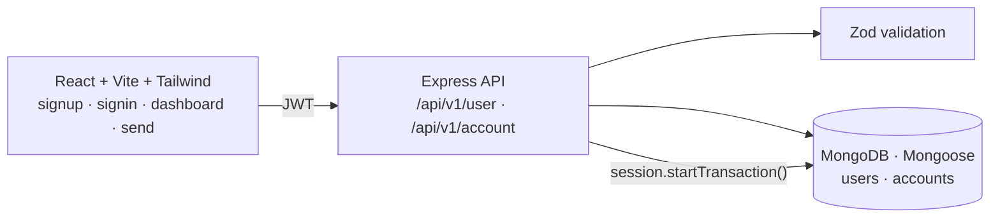

## Build a basic version of PayTM

### Peer-to-peer wallet app: a basic Paytm clone

     

Users sign up, get a wallet balance, search for other users, and send them money. Transfers run inside a **MongoDB transaction**, so a failed debit or credit never leaves balances inconsistent.



```bash
cd backend && npm install && node index.js      # set MongoDB URL + JWT secret in config.js / .env
cd frontend && npm install && npm run dev
```
